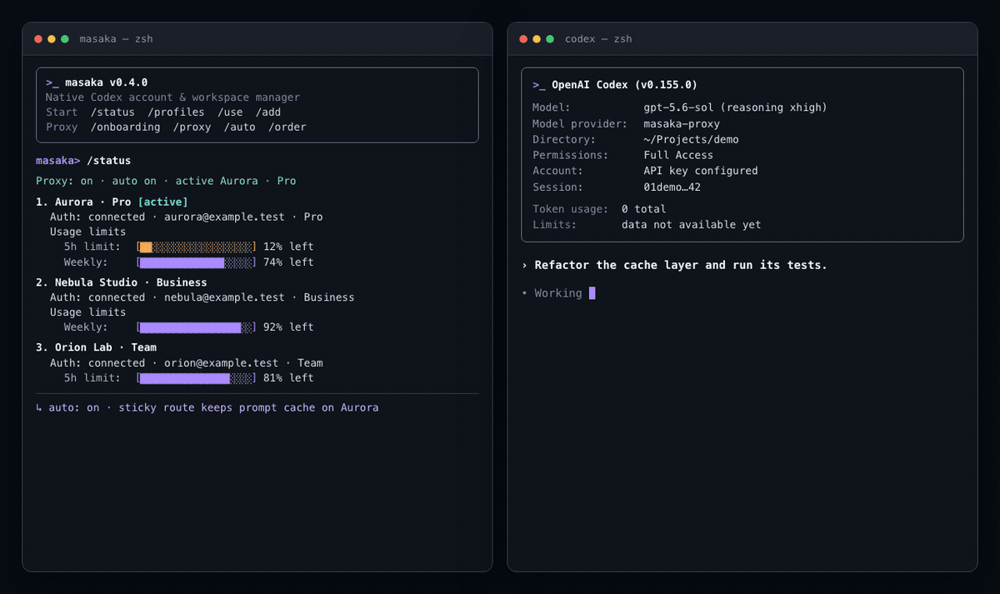

<p align="center"></p>

<h1 align="center">Masaka · Codex Multiple Environments</h1>

<p align="center">无需反复 logout/login，在原生 Codex CLI 中切换隔离的 ChatGPT 账号与 Workspace。</p>

<p align="center"><a href="./README.md">English</a> · 简体中文 · <a href="./README.ja.md">日本語</a> · <a href="./README.ko.md">한국어</a> · <a href="./README.de.md">Deutsch</a> · <a href="./README.fr.md">Français</a> · <a href="./README.es.md">Español</a> · <a href="./README.pt-BR.md">Português</a></p>

## 安装

需要 macOS 或 Linux、Node.js 22+、Python 3，以及官方
[Codex CLI](https://developers.openai.com/codex/cli/reference/)。

```bash
npm install -g @masakaai/codex-multiple-env
masaka doctor
masaka
```

<p align="center"></p>

动画中的 Profile 与额度均为虚构数据。它展示了实际切换边界：正在输出的响应
继续使用原账号，下一次原生 Codex 请求才跟随 Masaka 的新路由。

Masaka 是独立的账号管理终端，不是另一个 Agent CLI，也不会替换 Codex
界面。你在 `masaka` 中添加、查看、续登、删除或选择 Profile，之后仍然
直接运行原生的 `codex`。

每个 Profile 严格对应一个 `(ChatGPT 账号, ChatGPT Workspace)` 组合，并
拥有独立的 `CODEX_HOME`。浏览器登录、Token 刷新和凭据文件始终由官方
Codex 管理。

## Shell 集成

让普通的 `codex` 命令使用已选择的 Profile：

```bash
echo 'eval "$(masaka shell-init)"' >> ~/.zshrc
eval "$(masaka shell-init)"
```

Bash 请写入 `~/.bashrc`。Masaka 只输出集成脚本，不会自动修改 shell 配置。
如果原来使用 `codex` alias 添加默认参数，请改用数组：

```bash
MASAKA_CODEX_DEFAULT_ARGS=(--search -m gpt-5.6-sol)
eval "$(masaka shell-init)"
```

## 使用

```bash
masaka
```

```text
masaka> /add
[打开官方 Codex 浏览器登录]
masaka> /profiles
1. Alice (alice@example.com) · Personal
2. Alice (alice@example.com) · Acme (Business) [default]
masaka> /use 1
masaka> /exit
```

然后照常启动原生 Codex：

```bash
codex
codex --search
codex exec "总结这个仓库"
```

### 可选：运行中热切换 Proxy

Apple Silicon macOS 用户可以完成一次 onboarding：

```text
masaka> /onboarding
```

它会下载经过固定版本和 SHA-256 校验的本地 Proxy runtime，安装当前用户的
launchd daemon，并启用 Proxy 模式。第一次启用后重启现有 Codex 一次；以后
`/use` 会让已经运行的 Codex 在**下一次请求**使用目标 Profile，当前正在输出的
响应不会中断。

默认 `/auto true`。自动策略保持当前账号以保留 prompt cache，只有其 5 小时
剩余额度降到 5% 或以下、认证不可用或进入 cooldown 时才切换。默认候选顺序为
Pro → Business/Team → 其他套餐；同档优先剩余额度更多的账号，无 5 小时窗口的
账号优先于有限窗口。用 `/order` 自定义完整顺序。

Proxy 模式下，原生 Codex 使用一个仅含 loopback 占位 key 的独立客户端身份；
真实 OAuth Profile 只由 daemon 读取与刷新，交互式 TUI 和 `codex exec` 均适用。

## 命令

| 命令 | 功能 |
| --- | --- |
| `/status` | 查看所有账号的登录状态、套餐、Token 活跃度、5 小时及其他限额窗口 |
| `/usage` | 查看所有账号可用的 reset cards 数量及返回的过期信息 |
| `/profiles` | 查看全部账号、Workspace、套餐与当前选择 |
| `/use 名称\|编号` | 选择后续新启动的原生 Codex 使用的 Profile |
| `/auto [true\|false]` | 查看或设置自动切换；默认开启，5 小时剩余 ≤5% 时切换 |
| `/order` | 查看顺序；`/order 3 1` 移动账号；`/order auto` 恢复默认规则 |
| `/proxy on\|off` | 选择新启动 Codex 使用 Proxy 或官方直连 |
| `/onboarding` | 安装并启动当前用户的本地 Proxy daemon |
| `/add [名称]` | 在全新隔离 Profile 中运行官方 `codex login`；默认自动命名 |
| `/renew 名称\|编号` | 所有相关会话关闭后，为同一身份重新登录 |
| `/delete 名称\|编号` | 要求输入完整名称确认，再移动到可恢复的 trash |
| `/exit` | 只退出 Masaka 管理终端 |

也可以直接执行 `masaka status`、`masaka use 2` 等终端命令。

## `/status` 与 `/usage`

Proxy onboarding 前，Masaka 通过官方 Codex App Server 的只读接口
`account/read`、`account/rateLimits/read` 和 `account/usage/read` 获取数据。
daemon 接管刷新后，状态页直接只读相同的 ChatGPT 账号数据；遇到 401 时只让
daemon 刷新，不再创建第二个 AuthManager。300 分钟窗口显示为 `5h`；剩余百分比
和重置时间均由服务端返回值计算。

`/usage` 以服务端 `availableCount` 为准。服务端可能限制明细行数量，因此
卡片总数可能大于显示的明细数。接口说明见
[Codex App Server 文档](https://developers.openai.com/codex/app-server/#auth-endpoints)。

## 直连与 Proxy 的切换边界

直连模式下，`/use` 只影响后续新启动的 Codex。Proxy 模式下，登录和 Workspace
发现仍走官方服务，只有模型请求经本机 `127.0.0.1` daemon；因此 `/use` 可以让
已经运行的客户端在下一次请求切换路由。正在输出的响应继续使用原账号。

运行中的 Codex 会缓存 AuthManager、账号和 Workspace 策略。替换
`auth.json`、切换软链接或注入其他账号 Token 会与刷新流程竞争，正是产生
以下错误的典型原因：

```text
Your access token could not be refreshed because you have since logged out
or signed in to another account.
```

Proxy 客户端使用独立的 API-key 身份，因此原生 `/status` 会显示
`Model provider: masaka-proxy` 与 `Account: API key configured`，但无法显示
daemon 后面当前选择的 OAuth Profile；代理实际账号、限额与 Credits 以
`masaka /status` 为准。
`/proxy off` 会等待在途响应结束、停止 daemon，并把 token 刷新所有权交还给
直连模式。原先连接 Proxy 的 Codex 需要重启；这个明确交接可以避免两个进程
同时刷新同一个 token。

## 安全边界

- 一个 Profile 只保存一个账号与 Workspace 组合，并拥有一个 `CODEX_HOME`。
- 永不复制、链接或替换全局 `~/.codex/auth.json`。
- 启动 Codex 前清除环境中的 API/access token 和认证端点覆盖变量。
- 拒绝软链接、硬链接凭据。Proxy 模式支持多个 Codex 会话，因为 OAuth 只由
  daemon 刷新；直连模式每个 Profile 只允许一个托管会话，`/renew` 与
  `/delete` 同样需要独占锁。
- Profile 目录为 `0700`，元数据和凭据文件为 `0600`（POSIX 平台）。
- Masaka 不额外加密。`cli_auth_credentials_store="file"` 使用 Codex 官方
  `auth.json` 文件存储；请把它当作密码保护。详见
  [官方凭据存储文档](https://developers.openai.com/codex/auth/#credential-storage)。
- Proxy runtime 来自 MIT 许可的 CodexMulti `proxy/`，固定为 v0.2.15 并在
  解包前校验 SHA-256；Masaka 只额外加入 refresh/reload 互斥补丁。详情见
  [THIRD_PARTY_NOTICES.md](./THIRD_PARTY_NOTICES.md)。

本项目由 MASAKA AI 独立开发，不是 OpenAI 官方产品，也未获 OpenAI 背书。
Apache-2.0 开源；安全问题请查看 [SECURITY.md](./SECURITY.md)。
